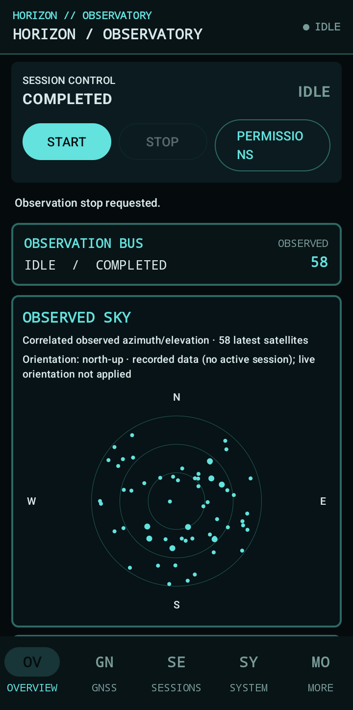

# HORIZON Observatory

> **A satellite-aware Android observatory for observing positioning, orbital context, and the signals around you.**

Horizon is a local-first scientific observation platform built around one rule:

**capture what the system actually observes, preserve the evidence, and derive from it downstream.**

It combines **raw GNSS measurements, satellite status, navigation messages, cellular observations, sensors, and location/PVT** into a durable observation pipeline, then extends that foundation toward **orbital observation and propagation** behind an explicit OMM → SGP4/SDP4 boundary.

This is not a location screen.

It is an **observatory stack**: acquisition, provenance, persistence, integrity, analysis, resilience, orbital context, replay, export, and instrument-style visualization—kept separate enough that a reviewer can trace a value back toward its original evidence.

<p align="center">
  
</p>

<p align="center">
  <sub>Physical-device capture — Samsung SM-A075F / Android 16.</sub>
</p>

**GNSS · Satellites · Orbital Context · SGP4/SDP4 · Cellular · Sensors · Provenance · Resilient Navigation**


## Latest APK — 2026-10-14 device build

**[Download the latest APK](https://github.com/Vice13th/Horizon-Observatory/releases/download/v1.0.0-observatory-device-2026-10-14/Horizon-Observatory-v1.0.0-observatory-device-2026-10-14.apk)** · [Release notes, verification details, and checksum](https://github.com/Vice13th/Horizon-Observatory/releases/tag/v1.0.0-observatory-device-2026-10-14)

- Release tag: `v1.0.0-observatory-device-2026-10-14` (pre-release)
- Variant/package: `primaryDebug` / `horizon.observatory.debug`
- App version: `1.0.0-observatory` (versionCode `1`)
- Tested device: Samsung SM-A075F, Android 16 / API 36
- APK size: 10,623,016 bytes (about 10.1 MiB)
- APK SHA-256: `327756805061763A2CD691E1F4D46ACDE1DE352E26A7E9594A46DFE779F72D33`
- [SHA-256 sidecar](https://github.com/Vice13th/Horizon-Observatory/releases/download/v1.0.0-observatory-device-2026-10-14/Horizon-Observatory-v1.0.0-observatory-device-2026-10-14.apk.sha256)

The APK signature and package metadata were checked, and this exact artifact was installed/launched on the target device. The public-checkout JVM test tasks `:app:testPrimaryDebugUnitTest` and `:orbitcore-bridge:test` passed.

**Important:** this is a debug-signed device build, not a production/Play Store release. It was built from a preserved local source snapshot without Git metadata, so it is not claimed to be reproducible from the release tag's source commit. Device launch verification is not full validation of every feature.

The earlier [v1.0.0-observatory release](https://github.com/Vice13th/Horizon-Observatory/releases/tag/v1.0.0-observatory) remains available as a separate artifact.

## Current Status

**Core GNSS evidence pipeline: verified for the documented checkpoint; broader device and scientific gates remain open.**

The current evidence chain is verified on a physical Samsung SM-A075F through:

`GNSS acquisition → Observation Bus → persistence → Room readback → export → checksum/readback → semantic normalization`

Fresh checkpoint evidence records:

- **3,250 observations** with contiguous sequence **1..3250**
- ingestion timestamps present for **3250/3250** observations
- ingestion timestamps non-decreasing
- bounded raw GNSS inspection with preserved constellation, SVID, C/N0, satellite time, pseudorange-rate, and ADR
- explicit JSON `null` preservation for absent carrier phase fields
- verified Room readback and export checksum/readback
- **167 JVM tests: 0 failures / 0 errors / 3 pre-existing skips**
- direct instrumentation: **1 test / 0 failures / 0 errors**

Latest runtime evidence on the target device additionally records:

- **Samsung SM-A075F / Android 16 / API 36**
- **10,961 observations**
- **0 error events**
- sequence **1..10,961** contiguous
- ingestion timestamps non-decreasing
- integrity audit clean
- GNSS raw measurements, navigation messages, accumulated delta range, multi-frequency, cellular fresh-update API: **OBSERVED/SUPPORTED**
- antenna information: **UNSUPPORTED**
- carrier phase and AGC capability: **UNVERIFIED**

See:
- `docs/VERIFICATION_MATRIX_CURRENT.md`
- `docs/LATEST_RUNTIME_EVIDENCE_C40.md`
- `docs/receipts/POST_MIGRATION_REGRESSION_2026-10-06.md`

## Satellite & Orbital Observation

Horizon is designed to connect what a device **measures in the sky** with what an orbital model can **predict about objects in orbit**.

The current architecture keeps these domains explicitly separated:

```
GNSS / Device Measurements
        |
        +---- satellite observations
        +---- signal state / C/N0 / geometry
        +---- navigation messages
        +---- PVT / sensor / cellular evidence
        |
        v
  Observation + Evidence Layer
        |
        +-----------------------------+
        |                             |
        v                             v
  Positioning / Resilience       Orbital Context
                                      |
                                  Catalog / OMM
                                      |
                               Propagation Contract
                                      |
                               OrbitCore SGP4 / SDP4
                                      |
                          Frame / Topocentric Geometry
                                      |
                               Visibility / Pass State
```

The orbital path is implemented behind a dedicated propagation contract with an **OrbitCore SGP4/SDP4 backend**, including deep-space handling and provenance-preserving identity fallbacks.

Scientific reference-vector accuracy remains an explicit validation gate rather than an implied claim.

**NORAD mapping is intentionally UNKNOWN** until an authoritative, time-valid mapping source and deterministic resolver evidence are available. No constellation/SVID → NORAD identity is guessed.

## Resilient Positioning

Horizon treats GNSS loss or degradation as an engineering state—not a reason to silently invent a position.

The resilience architecture can combine evidence from:

- GNSS measurements and status
- last trusted PVT/navigation state
- inertial and orientation context where actually available
- cellular/network evidence
- validated software-derived or propagated state

Observed, derived, predicted/propagated, and dead-reckoned states remain distinct, with provenance and uncertainty carried forward rather than hidden behind a single coordinate.

## Target Device & Platform

- Device: **Samsung Galaxy A07 / SM-A075F**
- Android: **16 / API 36**
- minSdk: **26**
- compileSdk / targetSdk: **36**
- Application ID: `horizon.observatory`
- Default branch: `main`

## Architecture

```text
Android platform APIs
    |
    +--> GNSS acquisition
    +--> Cellular acquisition
    +--> Sensor acquisition
    +--> Location/PVT acquisition
              |
              v
       Domain observations
              |
              v
        Observation Bus
              |
              v
      SessionSequencer
      (per-session ordering)
              |
              v
   Reliable Room-backed queue
              |
              v
        Room evidence store
              |
              +--> Integrity audit
              +--> Semantic normalization
              +--> Analysis / replay
              +--> Export / readback
              +--> Resilience
              +--> Compose Observatory UI
```

Core architectural boundaries:

- **Observation timestamp** = source/evidence time when exposed by the platform
- **Ingestion timestamp** = monotonic ordering clock used by Horizon
- **Sequence number** = session-scoped evidence ordering, not process-global
- **Raw payload** = preserved evidence
- **Normalized payload** = derived view over preserved raw evidence
- **Observed / Derived / Predicted / Dead-Reckoned / Unknown / Unavailable** remain semantically distinct

## Integrity Guarantees

1. Session lifecycle transitions are validated and persisted with compare-and-set semantics.
2. Observation sequence numbers are allocated per session, not process-wide.
3. `(sessionId, sequenceNumber)` is unique in the evidence store and pending queue.
4. Monotonic ingestion timestamps are propagated through persistence/export where available.
5. Pending observations are durably staged before being drained into the evidence table.
6. Queue drain moves each observation to evidence and deletes its pending row in one Room transaction.
7. Domain models are mapped explicitly to persistence entities.
8. Capability, evidence, and provenance metadata use typed domain representations.
9. Production acquisition does not fabricate GNSS, cellular, sensor, or navigation values.
10. Raw, normalized, derived, and model-level data remain conceptually separate.
11. Export integrity is validated against Room counts, sequence continuity, timestamp ordering, and internal checksums.
12. Missing capability or uncertain identity is represented explicitly rather than upgraded by inference.

## Acquisition

- GNSS raw measurements
- GNSS satellite status
- GNSS navigation messages
- GNSS antenna information where exposed by Android
- GNSS/PVT location fixes
- GSM / WCDMA / LTE / NR cell information where Android exposes it
- runtime sensor discovery and event acquisition

All optional capabilities are treated as runtime facts. `UNVERIFIED`, `UNKNOWN`, and `UNAVAILABLE` are used where evidence does not establish a stronger claim.

## Orbital / Scientific Boundaries

The orbital and scientific domains are deliberately protected from presentation-layer shortcuts.

Frozen scientific domains for the current GNSS foundation checkpoint:

- raw GNSS evidence schema/semantics
- Observation Bus semantics
- Room persistence path
- export evidence path
- OrbitCore
- SGP4 / SDP4
- propagation contract
- scientific propagation behavior

The UI may be radically redesigned, but it cannot:

- invent measurements
- invent satellite identities or NORAD IDs
- invent orientation
- alter raw observation semantics
- convert predicted state into observed state
- convert UNKNOWN into KNOWN

## UI

The Compose Observatory is being redesigned as a **scientific observatory / aerospace telemetry interface**, not a generic Material dashboard.

Current direction:

**OBSERVE / SIGNALS / ORBIT / SESSION / EVIDENCE**

The primary live view is intended to center the sky/satellite instrument, session state, observation health, PVT/fix state, integrity/freshness, and compact active-satellite readouts.

Satellite panels should prefer:

**CONSTELLATION / SVID / C/N0 / AZ / EL / DOPPLER / AGE / STATE**

The interface must preserve explicit distinctions between observed, derived, propagated, dead-reckoned, unknown, and unavailable information.

Performance constraints remain part of the architecture:

- no duplicate collectors
- no unbounded polling
- no full-list recomputation per frame
- no database queries from composables
- no runaway recomposition
- no unbounded UI allocations
- keep the existing bounded live UI projection unless new evidence proves a safer design

See `docs/UI_UX_RADICAL_REDESIGN_DIRECTIVE_2026-10-06.md` and `docs/DESIGN_HANDOFF.md`.

## Export

A session export is generated as an atomic ZIP containing:

- `dataset_manifest.json`
- `observations.json`
- `observations.csv`

The export path verifies Room count, JSON count, CSV row count, manifest count, sequence continuity, timestamp ordering, and package checksums before finalization.

A post-migration real-device regression also verified **two independent successful exports** from the same 2,759-observation session, with stable payload files byte-identical between the exports.

## Build & Test

On Windows:

```powershell
powershell -ExecutionPolicy Bypass -File .\scripts\BUILD_WINDOWS.ps1
```

The build path records the repository's Gradle wrapper/bootstrap behavior and runs the Android build and unit-test gates.

For the physical A07 validation path:

```powershell
powershell -ExecutionPolicy Bypass -File .\scripts\VERIFY_A07.ps1
```

The verification script checks device identity/API level, installs the debug APK, checks declared permissions, and captures an initial logcat diagnostic snapshot.

The current post-migration receipt verified:

- build successful
- installed APK hash matched the built APK
- real-device recording completed
- GNSS and cellular available
- session completed normally
- export #1 and export #2 succeeded
- archive extraction and internal checksums succeeded
- sequence continuity and monotonic ingestion were preserved

## Open Validation Gates

The current evidence-backed gates are intentionally explicit:

### NORAD mapping — UNKNOWN

The resolver remains intentionally empty until authoritative mapping evidence exists.

### Device-specific UTC edge case — UNVERIFIED

Requires target-device instrumentation and a dedicated evidence receipt.

### Physical orientation / panel rotation — UNVERIFIED

The target device does not currently establish the required orientation evidence for claiming orientation-aware UI behavior.

### K8 hardware / long-run validation — PENDING

Long-run resource stability and physical interference/degradation remain separate engineering gates.

### Scientific OrbitCore reference vectors — UNVERIFIED

The orbital implementation exists, but reference-vector accuracy is still a scientific validation gate.

## Engineering Rule

Horizon follows:

```
INSPECT → REPORT → IMPLEMENT → TEST → BUILD → DEVICE VERIFY → DOCUMENT
```

The repository treats the **current source, current checkpoint, canonical device receipts, verification matrix, and current handoff** as the source-of-truth hierarchy. Historical chat context is not repository truth.

---

**HORIZON Observatory**  
**Observe the evidence. Preserve the boundary. Derive without fabrication.**


## GNSS interference detection and resilient PNT (research roadmap, 2026-10-22)

A new evidence-backed roadmap proposes capability-aware AGC/C/N0 monitoring, explicit incomplete-data states, an explainable multi-indicator detector, and uncertainty-aware PNT fallback. It does **not** claim a detector is implemented or validated, and no software can guarantee satellite lock under effective RF interference. The first priority is callback/queue/persistence loss accounting, followed by API-aware signal telemetry and a transparent anomaly engine.

- [Research and implementation roadmap](docs/research/GNSS_INTERFERENCE_DETECTION_AND_RESILIENT_PNT_ROADMAP_2026-10-22.md)
- Official Android references: [raw GNSS](https://developer.android.com/develop/sensors-and-location/sensors/gnss), [jamming/spoofing](https://developer.android.com/develop/sensors-and-location/sensors/gnss-spoof-jam), [GnssMeasurement/AGC API](https://developer.android.com/reference/android/location/GnssMeasurement)
- Peer-reviewed baseline: [Spens et al., NAVIGATION (2022)](https://navi.ion.org/content/69/3/navi.537); [Miralles et al. (2018)](https://doi.org/10.33012/2018.15883)
